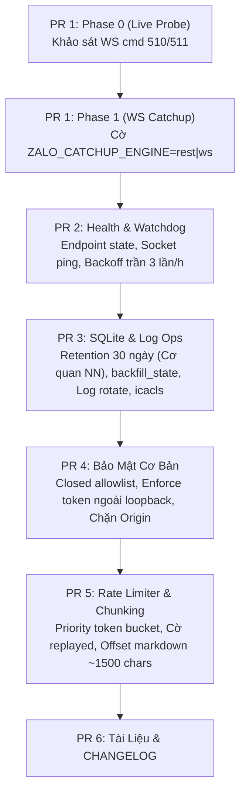

# Kế Hoạch Nâng Cấp hermes-zalo-plugin (Bản V2.1 - Chốt Chuẩn Bị Triển Khai PR 1)

> [!IMPORTANT]
> Bản cập nhật V2.1 đã chốt hai điều kiện kỹ thuật then chốt cho PR 1:
> 1. **Probe chạy độc quyền**: Script probe bắt buộc kiểm tra port 8787 (đảm bảo bridge đã tắt) và đợi `listener.ws?.readyState === 1` trước khi bắn gói WS, tránh code 3000 Duplicate Connection.
> 2. **Xử lý `fromTs` chuẩn xác**: **Nếu loại thread chưa có checkpoint $\to$ bỏ qua catch-up hoàn toàn** (tránh dội lại 2 giờ tin cũ). Chỉ khi có checkpoint mới kẹp window và trừ 30 giây buffer.

---

## 1. Tổng Quan & Phát Hiện Cốt Lõi

1. **Giao Thức Lấy Lịch Sử Qua WebSocket (cmd 510/511)**:
   - DM (Direct Message): `cmd 510`, `subCmd 1` (`ThreadType.User` = 0).
   - Group: `cmd 511`, `subCmd 1` (`ThreadType.Group` = 1).
   - Gửi qua WS: `{ version: 1, cmd, subCmd: 1, data: { first: true, lastId: lastMsgId, preIds: [] } }`.
   - Nhận về qua event: `listener.on("old_messages", (msgs, threadType) => ...)`.
2. **Phạm Vi Toàn Tài Khoản (Account-wide Scope)**:
   - Request lấy theo toàn bộ tin nhắn gần nhất của tài khoản theo loại thread, phân trang lùi bằng `lastMsgId` của tin cũ nhất trong trang trước.
   - Nhờ vậy, catch-up chỉ cần 2–5 frame WS cho mỗi loại thread thay vì quét hàng trăm thread tuần tự.
3. **Trạng Thái Hiện Tại**:
   - Khả năng này đã được xác nhận tồn tại trong mã nguồn `zca-js@2.1.2` (`dist/apis/listen.js`), **chưa được xác minh live trên tài khoản thực tế**. Phase 0 là bước kiểm chứng bắt buộc.

---

## 2. Tiêu Chí Nghiệm Thu Đầy Đủ (Acceptance Criteria)

### PR 1 (Phase 0 Probe & Phase 1 WS Catchup):
- **Probe Phase 0**:
  - Tự động kiểm tra port 8787: nếu bridge đang chạy $\to$ cảnh báo và dừng ngay.
  - Chờ `listener.ws?.readyState === 1` rồi mới gửi request.
  - **Không in nội dung tin nhắn ra console** (bảo vệ quyền riêng tư).
  - Trả về rõ ràng: số lượng tin/trang, kiểu dữ liệu `ts` (chuỗi hay số), khoảng `ts` đầu/cuối, thứ tự sắp xếp (mới $\to$ cũ hay cũ $\to$ mới), số tin `uidFrom === ownId`, và kiểm tra cursor trang 2 có cũ hơn trang 1 không.
- **Unit/Mock Test Phase 1 (Listener Giả)**:
  - Trường hợp 1: Timeout quá 6s $\to$ waiter được giải phóng an toàn, trả về `null`, không treo.
  - Trường hợp 2: Cursor lặp lại giữa 2 trang $\to$ dừng vòng lặp ngay lập tức.
  - Trường hợp 3: Tin của chính bot (`uidFrom === ownId`) $\to$ bị lọc bỏ hoàn toàn.
  - Trường hợp 4: Đổi thứ tự trang $\to$ kết quả cuối cùng luôn được sắp xếp theo thời gian tăng dần (`asc`).
  - Trường hợp 5: Waiter bận (đang có request cho loại đó) $\to$ guard từ chối request thứ 2, không ghi đè waiter cũ.
  - Trường hợp 6: Chưa có checkpoint $\to$ bỏ qua catch-up cho loại thread đó.
- **Live Integration Test Phase 1**:
  - Kịch bản: Tắt mạng/ngắt kết nối bot khoảng 60 giây. Từ tài khoản khác, gửi đồng thời 1 tin DM và 1 tin Group. Sau đó bật lại mạng.
  - Kỳ vọng: Cả 2 tin bị lỡ được khôi phục chính xác 1 lần, checkpoint SQLite cập nhật, không có tin nào của bot bị phát lại, không có tin trùng lặp.

### PR 2 (Health & Watchdog):
- Giả lập listener mất kết nối 70 giây $\to$ watchdog gọi relogin đúng 1 lần.
- Lần thứ 4 trong cùng 1 giờ $\to$ watchdog **không chạy relogin**, giữ trạng thái `degraded` và ghi log mức `ERROR`.

### PR 3 (SQLite & File Ops):
- File `bridge.log` tự xoay vòng khi đạt 5MB, giữ tối đa 3 file backup.
- Quyền ACL của file SQLite trên Windows qua `icacls` giới hạn chỉ người dùng hiện tại có quyền truy cập.

### PR 4 (Bảo Mật Cơ Bản):
- Người lạ nhắn DM khi `ZALO_ALLOWED_USERS` có danh sách $\to$ bị bỏ qua và có log ghi nhận.
- Cấu hình `HOST=0.0.0.0` với `ZALO_PLUGIN_TOKEN` rỗng $\to$ bridge thoát ngay với mã 1 (exit code 1).

### PR 5 (Rate Limiter & Chunking):
- Gửi 10 tin liên tiếp $\to$ 5 tin đầu đi ngay (burst), các tin sau cách nhau tối thiểu 3 giây.
- Tin có mức ưu tiên `HIGH` luôn được xếp hàng trước tin `LOW`.

---

## 3. Lộ Trình Triển Khai Chi Tiết



---

### PR 1: Phase 0 (Live Probe) & Phase 1 (WS Catchup Engine)

#### 1.1. Script Live Probe (Phase 0)
- File: [scratch/probe_request_old.js](file:///d:/Antigravity/hermes-zalo-plugin/scratch/probe_request_old.js).
- **Điều kiện tiên quyết**: Kiểm tra port 8787 (đảm bảo bridge đã tắt). Nếu phát hiện tiến trình bridge đang chạy, script lập tức cảnh báo và thoát để tránh xung đột mã 3000 (Duplicate Connection).
- Chờ `listener.ws?.readyState === 1` trước khi gọi `requestOldMessages`.
- Gọi tối đa 2 lần cho DM (`ThreadType.User = 0`) và 1 lần cho Group (`ThreadType.Group = 1`).
- Chỉ tổng hợp metadata (count, tsType, order, min/max ts, selfCount, cursor check). Tuyệt đối không log nội dung.

#### 1.2. WebSocket Catchup Engine (Phase 1)
- **Feature Flag chuyển đổi**:
  - `ZALO_CATCHUP_ENGINE=rest|ws` (mặc định ban đầu là `rest`).
  - Giữ nguyên kill switch `ZALO_ENABLE_CATCHUP=false` và cơ chế Circuit Breaker (dừng nếu timeout/lỗi 2 lần liên tiếp).
  - Giữ lại auto-prune 404 cho engine REST cũ.
- **Quy tắc xác định `fromTs` chuẩn xác**:
  1. Kiểm tra checkpoint gần nhất của loại thread đó: `lastCheckpointTs = repository.getMaxCheckpointTs(threadType)`.
  2. **Nếu chưa có checkpoint (`!lastCheckpointTs || lastCheckpointTs <= 0`) $\to$ BỎ QUA CATCH-UP** cho loại thread đó (tránh kéo lại 2 giờ tin cũ làm bot spam trả lời lại).
  3. Nếu có checkpoint:
     $$\text{clampedTs} = \max(\text{lastCheckpointTs}, \text{Date.now}() - \text{ZALO\_CATCHUP\_MAX\_WINDOW\_MS})$$
     $$\text{fromTs} = \text{clampedTs} - 30\,000 \quad (\text{trừ buffer 30s sau bước kẹp window})$$
- **Guard Waiter Chống Ghi Đè**:
  - Mỗi loại thread chỉ cho phép 1 request đang pending:
  ```javascript
  if (this._oldWaiters.has(threadType)) {
    console.warn(`[zalo] requestOldMessages(${threadType}) đang bận, bỏ qua request mới`);
    return null;
  }
  ```
- **Phát hiện & Báo Cáo Cắt Trang (`truncated`)**:
  - Nếu duyệt hết `maxPages` (mặc định 5 trang) mà mốc tin cũ nhất trong trang vẫn lớn hơn `fromTs`:
    - Đánh dấu cờ `this._catchupTruncated[threadType] = true`.
    - Ghi log cảnh báo rõ ràng.
    - Xuất cờ `truncated: true` ra endpoint `/health`.

---

### PR 2: Health Monitoring & Watchdog Hardening

1. **Watchdog là tiến trình riêng biệt**:
   - Không thể đọc biến nội bộ `client._reconnecting`.
   - Phải dựa vào trường `state` trong endpoint `/health` (`"CONNECTING"`, `"CATCHUP"`, `"READY"`, `"DISCONNECTED"`).
   - Tuyệt đối không kích hoạt relogin nếu `state === "CONNECTING"` hoặc `state === "CATCHUP"`.
2. **Endpoint Soft-relogin Bảo Mật**:
   - Sử dụng `POST /relogin` (hoặc `POST /admin/relogin`) có middleware `checkAuth` bảo vệ bằng bridge token.
3. **Khống Chế Trần Relogin & Báo Lỗi Rõ Ràng**:
   - Tối đa **3 lần relogin trong 1 giờ** (`MAX_RELOGIN_PER_HOUR = 3`), kèm exponential backoff (10s, 30s, 90s).
   - Khi chạm trần 3 lần: **Dừng can thiệp, giữ nguyên trạng thái `degraded`, ghi log mức `ERROR` ra console và file log**. Không được im lặng bỏ qua.
   - Giám sát độ trễ dựa vào `lastSocketActivityAt` (ping/pong frame) thay vì `lastMessageReceivedAt`.

---

### PR 3: SQLite Retention & File Ops (Phù Hợp Bối Cảnh Cơ Quan Nhà Nước)

1. **Thời Gian Lưu Trữ Rút Gọn (30–90 Ngày)**:
   - Trong bối cảnh công văn, hồ sơ thầu, tài liệu nhà nước, việc giữ dữ liệu 365 ngày trên đĩa tiềm ẩn rủi ro lộ lọt thông tin.
   - Mặc định đổi về **30 ngày** (hoặc cấu hình qua `ZALO_SQLITE_RETENTION_DAYS`, 0 = chỉ lưu metadata/checkpoint, không lưu nội dung vĩnh viễn).
   - Job dọn dẹp chạy theo lô (batch deletion) định kỳ mỗi 24h, kèm lệnh `VACUUM` tuần một lần.
   - Tài liệu hoá rõ ràng: các file media/ảnh/file đính kèm được lưu trữ tại đâu trên đĩa.
2. **Tách Bảng `backfill_state`**:
   - Quản lý con trỏ phân trang, trạng thái catchup riêng biệt với bảng `messages`.
3. **Log Rotation & Phân Quyền Windows**:
   - Cắt log `bridge.log` ở ngưỡng 5MB, lưu tối đa 3 file backup.
   - Thiết lập quyền truy cập NTFS an toàn qua `icacls` trên Windows cho thư mục dữ liệu và file `zalo.sqlite`.

---

### PR 4: Bảo Mật Cơ Bản (Allowlist & Bridge Token)

1. **Allowlist Mặc Định Đóng (Breaking Change)**:
   - Sửa trong [hermes-plugin/adapter.py](file:///d:/Antigravity/hermes-zalo-plugin/hermes-plugin/adapter.py):
     - DM: Nếu `ZALO_ALLOWED_USERS` có cấu hình và người gửi không có trong danh sách $\to$ bỏ qua và ghi log `debug/info`.
     - Group: Kiểm tra chính sách nhóm (`ZALO_ALLOWED_THREADS` hoặc chỉ xử lý khi bot được @mention tường minh).
     - Kiểm tra đồng bộ với cơ chế allowlist của Hermes gateway để tránh mâu thuẫn ngữ nghĩa.
     - Hiển thị banner cảnh báo lớn khi khởi động nếu chế độ đóng đang hoạt động.
2. **Siết Chặt Bridge Token & Header Origin**:
   - Nếu `HOST !== "127.0.0.1"` và `HOST !== "localhost"` mà `ZALO_PLUGIN_TOKEN` để trống: **Thoát tiến trình ngay với mã 1 (exit 1)**.
   - Từ chối mọi request mang header `Origin` của trình duyệt.

---

### PR 5: Priority Rate Limiter & Smart Chunking (ĐÃ HOÀN THÀNH)

1. **Phân Biệt Tin Nhắn Ưu Tiên Thấp (Cờ `replayed`)**:
   - Khi engine catchup khôi phục tin nhắn lỡ, gắn cờ `replayed: true` vào event gửi sang adapter.
   - Khi Hermes gửi tin trả lời, truyền kèm `replayed: true` (hoặc `priority: "low"`) về endpoint `/send`.
   - **Chính sách**: Tin replayed có mốc thời gian quá 10 phút trước đó (`Date.now() - msgTimestamp > 10 * 60 * 1000`) sẽ tự động bị bridge hủy (`dropped: true`, `reason: "stale_reply"`) để tránh làm phiền hội thoại cũ.
2. **Token Bucket Rate Limiter (`lib/priority-rate-limiter.js`)**:
   - Burst: 5 tin. Refill: 20 tin/phút (1 token mỗi 3 giây).
   - Hàng đợi ưu tiên kép: `HIGH` (chat trực tiếp) luôn đi trước `LOW` (catchup/bulk/replay).
   - Đã tích hợp vào `sendText`, `sendAttachment`, `sendSticker`, `sendVoice`, `sendCard`, `react`, `undo`.
3. **Smart Chunking An Toàn (~1500 Chars) (`lib/smart-chunker.js`)**:
   - Giới hạn lý thuyết của Zalo là 3000 UTF-16, nhưng phụ tải bao gồm byte UTF-8 Tiếng Việt có dấu cộng JSON styles rất dễ chạm ngưỡng payload của Zalo WAF (sinh lỗi Unknown hoặc Error 112). Vì vậy, ngưỡng chunk an toàn được cố định là **~1500 ký tự** (hoặc cấu hình qua `ZALO_CHUNK_SIZE`).
   - Cắt tại các ranh giới tự nhiên (`\n\n`, `\n`, `. `, `, `, ` `).
   - Tự động tính toán lại offset style cho từng chunk (`chunkTextAndStyles`); nếu payload style bị lỗi từ Zalo API thì fallback về plain text để bảo toàn nội dung.
4. **Adapter Python (`hermes-plugin/adapter.py`)**:
   - Truyền `replayed: True` và `messageTs` khi reply tin nhắn từ raw metadata.
   - Bắt và xử lý kết quả `dropped: true` từ bridge khi tin nhắn quá hạn 10 phút.

---

### PR 6: Cập Nhật Tài Liệu & CHANGELOG

- Cập nhật comment trong hàm `_fetchThreadHistory` của `zaloClient.js`.
- Cập nhật RFC v8 (Step 0) và kiến trúc OpenZCA v3.
- Cập nhật `CHANGELOG.md` ghi nhận các breaking changes và biến môi trường mới.
